# Frost: online winter-clothing shop

A complete online shop for a real small business that sells winter clothing
in **Iraq and Kurdistan**: a mobile-first storefront, WhatsApp order
confirmation, and a private dashboard protected by two-factor sign-in.

**Website:** frostshop.store (launching soon) · **Stack:** React 18, Node.js, Express 5, SQLite

> The source code is private because it runs a live business.
> I'm happy to walk through it in an interview or share it on request.

  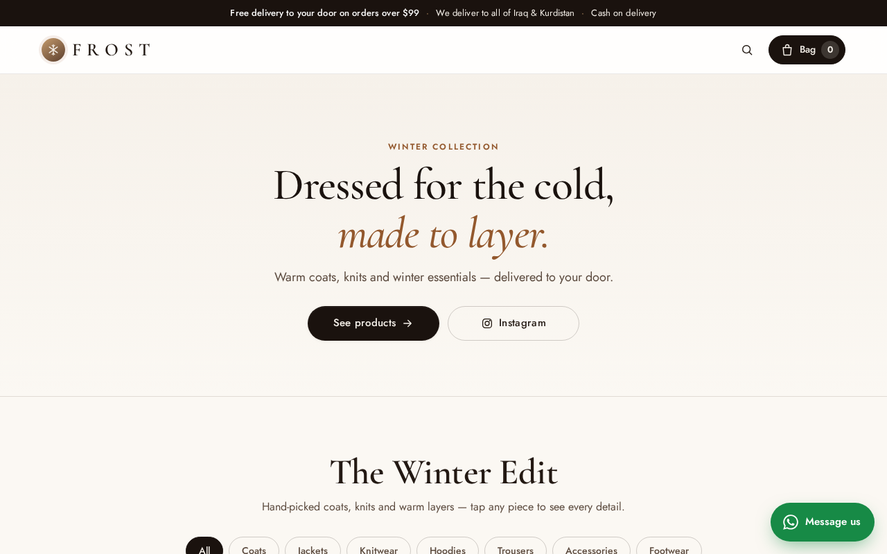
  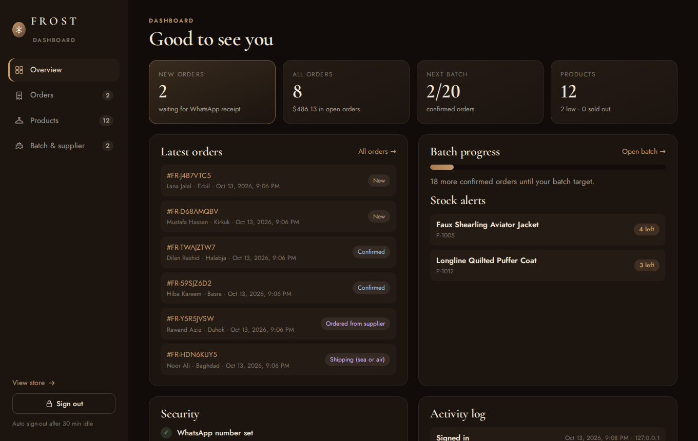

---

## The problem

The business pre-orders clothing from suppliers in China, collects orders, and
ships them together by sea or air to keep prices low. Before this site, orders
came in through Instagram messages and were tracked by hand. There was no
online card payment option, and customers wanted to see real prices, sizes and
photos before ordering.

## The solution

- Customers browse the catalog, pick sizes and colours, and place an order with
  their governorate and address.
- The server checks stock, sets the real prices and gives them a **receipt with
  a unique order number**.
- They pay **half online to register the order** and send a screenshot of the
  receipt on **WhatsApp**; the message is written for them.
- The owner checks the screenshot against the real order in the dashboard,
  confirms it, and the **Batch** view turns all confirmed orders into one
  shopping list for the supplier.
- The other half is paid on delivery. Delivery is free over $99.

---

## Screenshots

### Shop (customers)

| | |
|---|---|
| 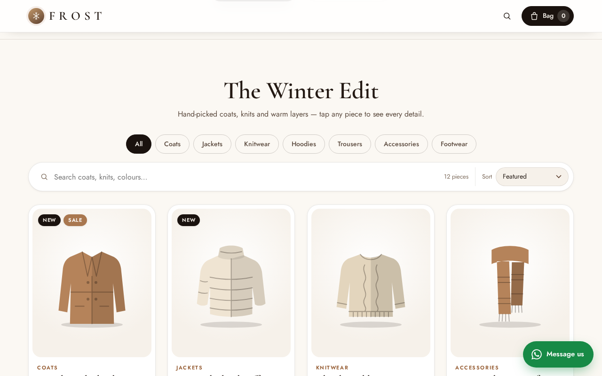 | 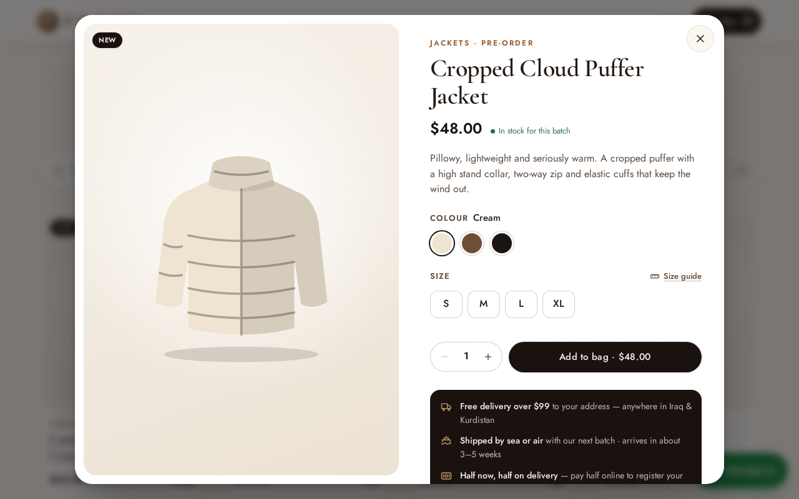 |
| Product grid with search, categories and stock tags | Product view: photo slider, sizes, colours, delivery info |
| 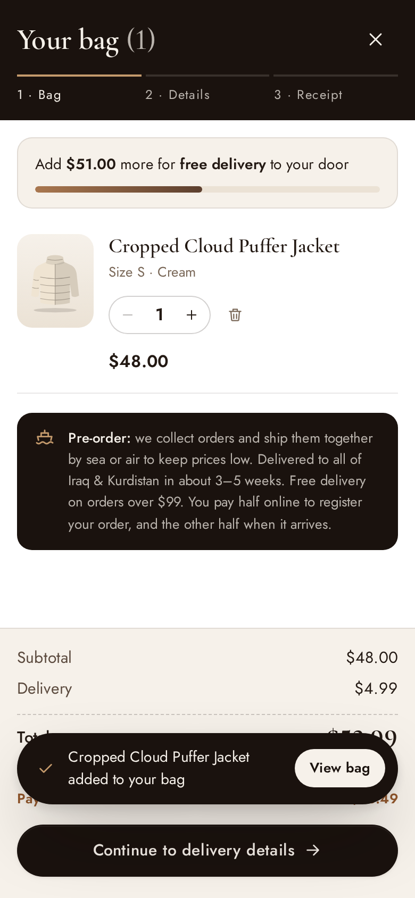 | 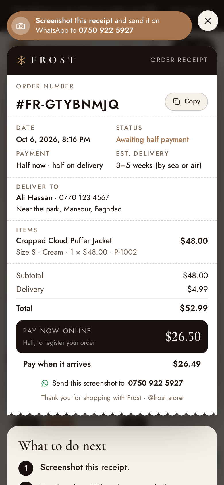 |
| Bag and checkout (half now, half on delivery) | Receipt sized for one phone screenshot |

### Dashboard (owner)

| | |
|---|---|
| 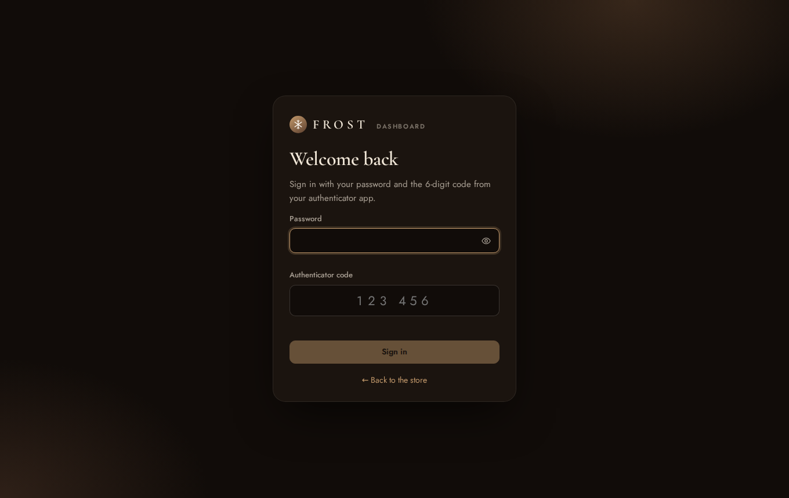 | 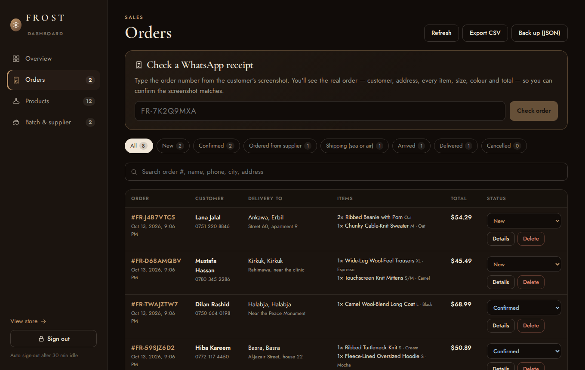 |
| Sign-in: password + authenticator code | Orders: receipt check, filters, CSV and JSON backup |
| 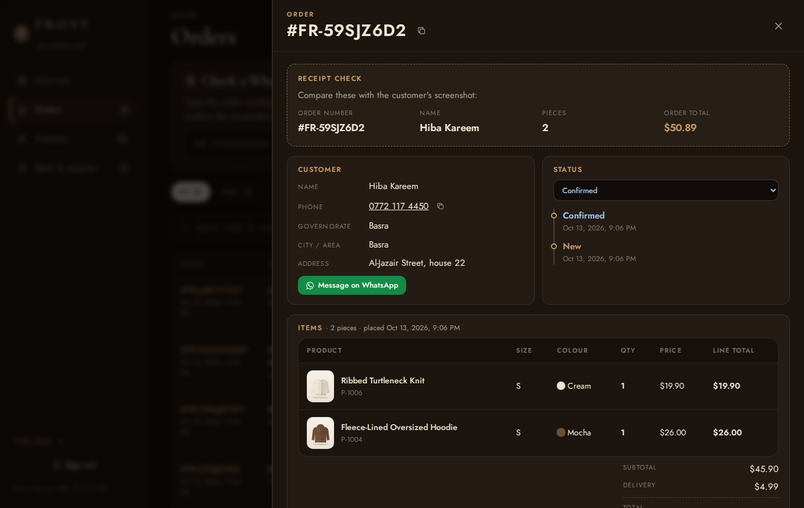 | 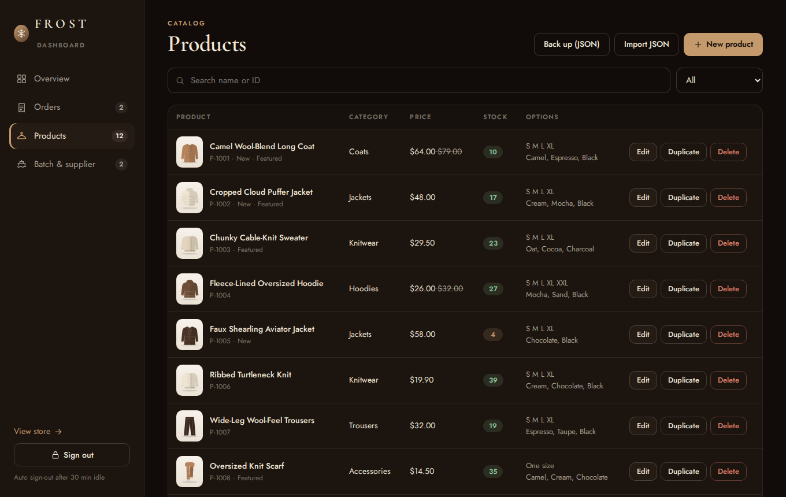 |
| Full order detail and status timeline | Products with photo uploads (1–5 per product) |
| 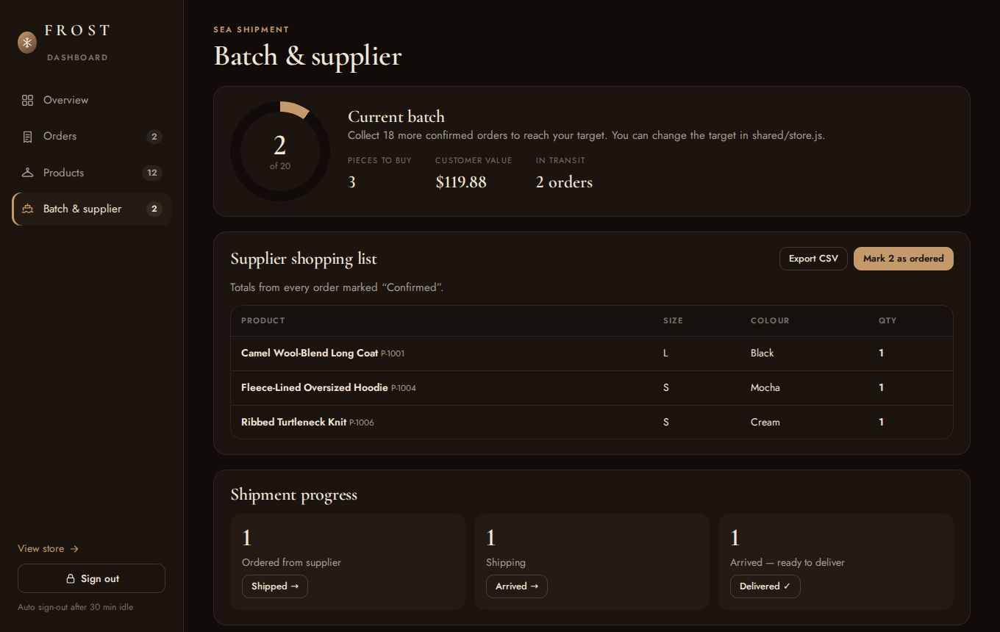 | 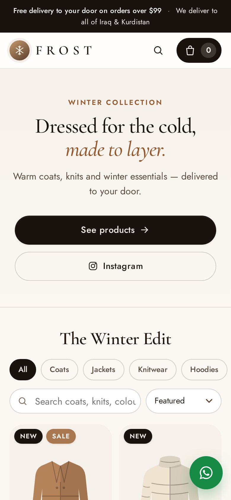 |
| Batch: one supplier list from all confirmed orders | Designed for phones first |

---

## How it's built

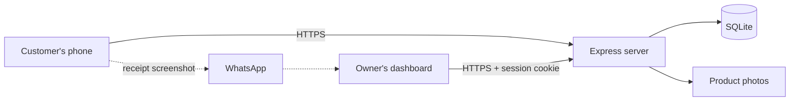

- **One Node.js app** serves both the React site and the JSON API.
- **Shared validation and pricing code** run in the browser (instant feedback)
  and again on the server (the source of truth).
- **SQLite** keeps the business simple to run and back up: one file for orders,
  products and sessions, plus a folder of photos.
- **40 automated tests** (Node's built-in test runner) start a real server and
  check the API and every security rule.

| Part | Technology |
|---|---|
| Frontend | React 18, Vite, plain CSS, self-hosted fonts |
| Backend | Node.js 22, Express 5 |
| Database | SQLite (better-sqlite3, WAL mode) |
| Security | Helmet, express-rate-limit, JWT sessions, scrypt, TOTP (RFC 6238) |
| Hosting | Railway (or a small VPS with Caddy for automatic HTTPS) |

---

## Security

Built against the **OWASP Top 10**, with a test for each rule below.

**Owner sign-in**
- Password hashed with **scrypt**; never stored or logged.
- **Two-factor** authenticator codes (TOTP); each code works only once.
- **Rate limiting:** 5 failed tries per connection; the account locks after
  10 failures. Every sign-in and change goes to an activity log.

**Sessions**
- A signed **JWT** in an **httpOnly, Secure, SameSite=Strict** cookie
  (`__Secure-` prefix). JavaScript can't read it.
- Each token points to a **server-side session**, so sign-out really ends it.
  Sessions end after 30 minutes idle or 8 hours.
- **Session fixation:** every sign-in creates a brand-new session.
- **Session theft:** a copied cookie used from another browser is refused, and
  the session is ended.

**Authorization**
- Sign-in is checked once for the whole admin API (deny by default).
- Every admin action needs a named permission; refusals are logged.

**Requests and data**
- **HTTPS everywhere** with HSTS.
- **Same-origin only:** CSRF header, Origin and Fetch Metadata checks.
- **Prices and stock** are worked out on the server inside a database
  transaction, so they can't be tampered with or oversold.
- **Customer receipts** need a secret token, which stops strangers reading
  other people's orders (IDOR).
- **SQL injection:** all SQL uses bound parameters.
- **XSS:** a strict Content Security Policy.
- **Photo uploads** are checked by their real file type.
- **No secrets** in the code or in git.

---

## What I learned

- Designing around a real business process (pre-orders, partial payment,
  WhatsApp) instead of a generic checkout.
- Layered security: why each protection exists and how to **prove** it works
  with tests rather than just adding it.
- Keeping a small production app simple to deploy, back up and maintain.

---

© 2026 Frost. All rights reserved. Screenshots show sample data.
